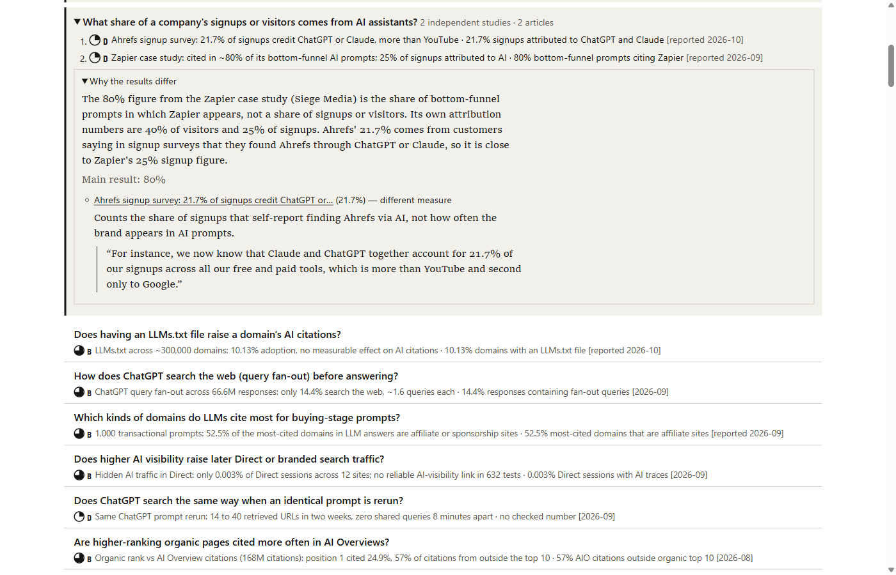
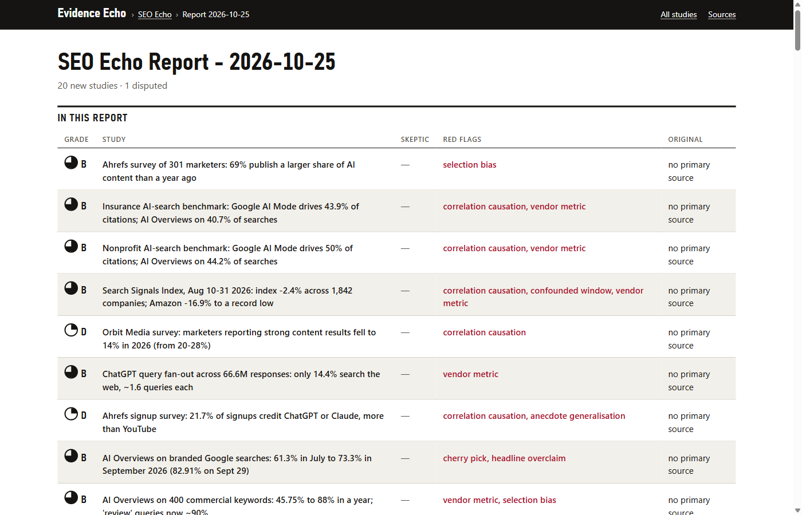

# Evidence Echo: evidence-based research digests for Claude Code

A Claude Code plugin that reads the RSS feeds and sites you follow, keeps only the articles that
report measured results, and grades each study's level of evidence: experiments, A/B tests,
large-scale data, case studies with numbers. Opinion pieces and announcements are filtered out.

See what it produces: [sample reports](#sample-reports) below.

- **Filters:** an article stays only if it reports a measured outcome; every rejection has a
  one-line reason.
- **Grades:** each study gets an evidence tier (A controlled experiment, B large-scale data,
  C case study, D practitioner anecdote), with quotes checked against the text by code, a
  blind second grader that challenges every grade, and a check against the original study an
  article cites.
- **Gives you:** a short report per run (Markdown and HTML), a list of everything rejected and
  why, and a topic page, "What the evidence says", that groups studies by question and puts
  conflicting results side by side. Optionally Obsidian notes.

### Use it for

| Template | For | Typical evidence |
|---|---|---|
| `seo` | SEO practitioners | SEO experiments, SEO case studies, ranking and AI-search data studies |
| `ai-coding` | engineering leads choosing AI coding tools | productivity studies, SWE-bench-style benchmarks, code quality and security of AI code |
| `cro` | growth and CRO marketers | published A/B tests, checkout and UX studies, experimentation methods |
| `exercise` | evidence-minded coaches and trainees | training studies, RCTs and meta-analyses on strength, endurance, recovery |

Any other topic starts blank: describe it in your own words and pick its sources.

### Sample reports

Static HTML pages from a real run of the four templates: nothing to install, just open them in
the browser. **[View sample reports →](https://r-hural.github.io/evidence-echo/)**

|  |  |
|---|---|
| **Topic page:** studies grouped by question, conflicting results side by side and why they differ | **Report:** each new study with its grade, red flags, the blind second grader's verdict and the original-study check |

## Install

    claude plugin marketplace add r-hural/evidence-echo
    claude plugin install evidence-echo@evidence-echo

Requirements: Claude Code and Python 3.11 or newer (`python`, `py -3` or `python3`). Nothing
else: the first command builds a private environment in the plugin's data folder (about a
minute), with [uv](https://docs.astral.sh/uv/) when available, otherwise `venv` and `pip`.

## First run

1. Start a Claude Code session and say "set up Evidence Echo" (or run `/evidence-echo:setup`).
   It asks one question at a time: where reports go, your first topic, its sources (each feed
   is checked) and the report defaults. No API key is needed.
2. Ask for an "Evidence Echo report". With several topics it asks which one to run.

The full manual (settings, topic files, sources, commands): [plugins/evidence-echo/README.md](plugins/evidence-echo/README.md).
Terms used throughout: [docs/GLOSSARY.md](docs/GLOSSARY.md).

## Cost and privacy

- **Where the judging happens.** By default the grading runs inside your own Claude Code
  session and counts toward your usage there. With an Anthropic API key in the plugin settings
  it can run through the API instead, billed to that key.
- **What leaves your machine.** Article and feed text goes to Anthropic only through the
  route above. With a Voyage AI key, study cards (the judge's short summary of each item: who
  ran the study, what was tested, findings, timeframe, sample, title; never article text) go to
  Voyage AI for embeddings. With an Apify token, LinkedIn sources are fetched through Apify
  (your token, billed to your Apify account). The plugin fetches only your configured sources
  and the articles and studies they link to: public addresses only, at most 5 MB per response,
  rate-limited per site. On first use it downloads its Python dependencies from PyPI (versions
  pinned in `constraints.txt`) into a private environment in the plugin's data folder.
- **What stays local.** Topics, the fetched text and grades (SQLite), reports, and the
  optional Obsidian export. Keys live in the plugin's data folder and are never printed or
  passed on the command line.

Details: [SECURITY.md](SECURITY.md).

## Content, copyright and personal data

Evidence Echo is a reading tool for your own use.

- Reports and notes hold excerpts and quotes of other people's articles, and author names.
  The articles belong to their authors; names and posts are personal data (GDPR and similar
  laws). Keep the output private, or check that publishing it is allowed. Always link to the
  original.
- You choose the sources and are responsible for following their terms. Optional LinkedIn
  sources go through a third-party scraper on Apify with your own token; LinkedIn's terms
  forbid scraping, so using them is your decision. Not affiliated with LinkedIn or Apify.
- Grades come from a language model and can be wrong. Health topics track research and are
  not medical, dietary or training advice.

Full text: [Content, copyright and personal data](plugins/evidence-echo/README.md#content-copyright-and-personal-data).

## Contributing

Issues are welcome; see [CONTRIBUTING.md](CONTRIBUTING.md). Changes: [CHANGELOG.md](CHANGELOG.md).

## License

[MIT](LICENSE)
